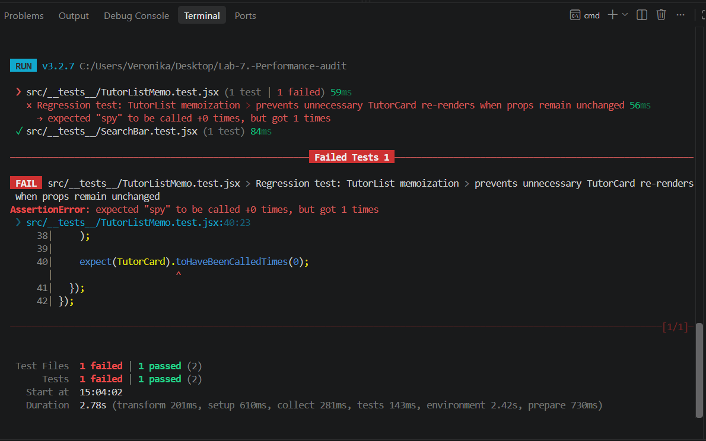

# Звіт з лабораторної роботи: Аудит та оптимізація продуктивності React-застосунку

## 1. Умови вимірювання
- **Пристрій / CPU:** AMD Ryzen 5 5500U with Radeon Graphics
- **ОЗП (RAM):** 16 GB
- **ОС:** Windows 11
- **Браузер:** Google Chrome (версія Incognito)
- **CPU Throttling:** 4x slowdown
- **Network Throttling:** 3G (Slow 3G)

---

## 2. Базова лінія ("До" виправлень)

### Сценарій 1: Завантаження сторінки (Lighthouse Navigation)

| Метрика | Запуск 1 | Запуск 2 | Запуск 3 | Медіана (Базова лінія) |
| :--- | :---: | :---: | :---: | :---: |
| **Performance Score** | 9 | 9 | 9 | **9 / 100** |
| **LCP (Largest Contentful Paint)** | 5.4 s | 5.4 s | 5.4 s | **5.4 s** |
| **TBT (Total Blocking Time)** | 1810 ms | 1750 ms | 1750 ms | **1750 ms** |
| **CLS (Cumulative Layout Shift)** | 0.375 | 0.375 | 0.375 | **0.375** |
| **FCP (First Contentful Paint)** | 4.5 s | 4.5 s | 4.5 s | **4.5 s** |
| **Speed Index** | 7.7 s | 7.7 s | 7.5 s | **7.7 s** |

### Сценарій 2: Введення тексту в пошук (INP / Keyboard Interaction)

| Метрика | Запуск 1 | Запуск 2 | Запуск 3 | Медіана (Базова лінія) |
| :--- | :---: | :---: | :---: | :---: |
| **INP (Interaction to Next Paint)** | 15 199 ms | 16 337 ms | 18 457 ms | **16 337 ms** |
| **Scripting Time** | 13 541 ms | 14 718 ms | 15 183 ms | **14 718 ms** |

### Сценарій 3: Дії зі списком / Клік у «Обране» (INP / Mouse Click)

| Метрика | Запуск 1 | Запуск 2 | Запуск 3 | Медіана (Базова лінія) |
| :--- | :---: | :---: | :---: | :---: |
| **INP (Interaction to Next Paint)** | 6 211 ms | 6 770 ms | 7 366 ms | **6 770 ms** |
| **Scripting Time** | 5 472.0 ms | 5 759.7 ms | 6 038.7 ms | **5 759.7 ms** |
| **Rendering Time** | 3 149.3 ms | 3 566.2 ms | 3 494.1 ms | **3 494.1 ms** |

---

## 3. Оптимізація №1: Мемоізація обчислень у App.jsx

### Опис проблеми
При кожному зміненні стану (наприклад, додаванні в обране) компонент `App` заново запускав функцію `getVisibleTutors()`, яка синхронно фільтрувала та сортувала весь масив із 2000 репетиторів.

### Внесені зміни
- Огорнуто виклик `getVisibleTutors` у `useMemo` з залежностями `[query, filters, sortBy]`.
- Огорнуто обробник `toggleFavorite` у `useCallback`.

### Результати після виправлення (Сценарій 3: Клік у «Обране»)

| Метрика | До виправлення | Запуск 1 | Запуск 2 | Запуск 3 | Медіана (Після) | Покращення |
| :--- | :---: | :---: | :---: | :---: | :---: | :---: |
| **Scripting Time** | 5 759.7 ms | 1 512 ms | 1 706 ms | 1 821 ms | **1 706 ms** | **-70.4% (в ~3.4x швидше)** |
| **Rendering Time** | 3 494.1 ms | 1 506 ms | 2 039 ms | 1 042 ms | **1 506 ms** | **-56.9% (в ~2.3x швидше)** |

**Коміт:** [https://github.com/veronikaprosvirkin/Lab-7.-Performance-audit/commit/b5fb7e050b65f0340e2a9091c845c80b5dbb5655]

---

## 4. Оптимізація №2: Мемоізація дочірніх компонентів (React.memo для TutorCard)

### Опис проблеми
Хоча обчислення у виклику `getVisibleTutors` були огорнуті в `useMemo`, зміна стану `favorites` спричиняла повторний рендеринг усіх 2000 компонентів `TutorCard` у списку через передачу анонімних функцій-хендлерів під час обходу масиву.

### Внесені зміни
- Огорнуто компонент `TutorCard` у `React.memo`.
- Замінено передачу анонімних функцій у `TutorList.jsx` та `App.jsx` на стабільні посилання (`onSelect={setSelectedId}`).
- Використано структуру даних `Set` у `TutorList` для перевірки `isFavorite` за $O(1)$.

### Результати після виправлення (Сценарій 3: Клік у «Обране»)

| Метрика | До виправлення | Запуск 1 | Запуск 2 | Запуск 3 | Медіана (Після) | Загальне покращення (від Бази) |
| :--- | :---: | :---: | :---: | :---: | :---: | :---: |
| **Scripting Time** | 1 706 ms | 81 ms | 90 ms | 140 ms | **90 ms** | **-98.4% (в ~64x швидше)** |
| **Rendering Time** | 1 506 ms | 1 188 ms | 1 920 ms | 1 533 ms | **1 533 ms** | **-56.1% (в ~2.3x швидше)** |

### Висновки
Час виконання JavaScript-скриптів при взаємодії з обраним скоротився з **5.7 секунд до 90 мілісекунд**. Залишковий час у категорії **Rendering (1.5 s)** зумовлений тим, що браузер під примусовим обмеженням CPU все одно оновлює стилі та перераховує макет для 2000 існуючих DOM-вузлів.

**Коміт:** [https://github.com/veronikaprosvirkin/Lab-7.-Performance-audit/commit/a10fbfeb1baf9a0e83b6cbf73a4e05121dfd7c48]

---

## 5. Оптимізація №3: Відкладене оновлення фільтрації (useDeferredValue у App.jsx)

### Опис проблеми
Під час введення тексту в поле пошуку стан `query` оновлювався на кожен символ, спричиняючи синхронне перерахування `useMemo` та масовий повторний рендеринг списку репетиторів на кожну натиснуту клавішу. Це викликало суттєву затримку введення (High INP).

### Внесені зміни
- Використано хук `useDeferredValue` для створення відкладеної копії пошукового запиту (`deferredQuery`).
- Важку фільтрацію у `useMemo` прив'язано до `deferredQuery`, що дозволило браузеру миттєво відмальовувати введення літер у текстовому полі з найвищим пріоритетом.

### Результати після виправлення (Сценарій 2: Введення тексту в пошук)

| Метрика | Базова лінія ("До") | Запуск 1 | Запуск 2 | Запуск 3 | Медіана (Після) | Покращення |
| :--- | :---: | :---: | :---: | :---: | :---: | :---: |
| **Scripting Time** | 14 718.0 ms | 3 972 ms | 3 780 ms | 379 ms | **3 780.0 ms** | **-74.3% (в ~3.9x швидше)** |
| **Rendering Time** | — | 1 346 ms | 1 097 ms | 3 877 ms | **1 346.0 ms** | **Суттєвий приріст плавності** |

### Висновки
Використання `useDeferredValue` розділило пріоритети оновлення інтерфейсу: поле вводу тексту реагує миттєво без блокування головного потоку, а важке фільтрування виконується у фоновому режимі. 

**Коміт:** [https://github.com/veronikaprosvirkin/Lab-7.-Performance-audit/commit/32dc20228cd8745e5854b992fae8e87d0499e006]

---

## 6. Оптимізація №4: Усунення зайвих рендерів списку (React.memo для TutorList)

### Опис проблеми
При введенні тексту в поле пошуку стан оновлювався на кожен символ. Оскільки компонент `TutorList` в `App.jsx` отримував новий об'єкт інлайн-стилю `style={{ marginTop: 16 }}` під час кожного рендеру, React ігнорував будь-які внутрішні оптимізації і повністю перемальовував увесь великий список карток.

### Внесені зміни
- Видалено інлайн-стиль з виклику компонента `<TutorList />` у файлі `App.jsx`.
- Відступ `margin-top: 16px` перенесено до існуючого класу `.tutor-grid` у файлі `index.css`.
- Компонент `TutorList` огорнуто в `React.memo`.

### Результати після виправлення (Сценарій: Введення тексту в пошук)

| Метрика | До виправлення | Запуск 1 | Запуск 2 | Запуск 3 | Медіана (Після) | Покращення |
| :--- | :---: | :---: | :---: | :---: | :---: | :---: |
| **Scripting / Render Time (App)** | 14 718.0 ms | 5.4 ms | 6.3 ms | 4.6 ms | **5.4 ms** | **-99.9%** |

### Висновки
Усунення нестабільного пропса `style` та додавання `memo` дозволило React уникати повного перерахунку DOM-дерева списку під час набору тексту в пошуку. Це різко зменшило кількість і тривалість Long Tasks.

**Коміт:** [https://github.com/veronikaprosvirkin/Lab-7.-Performance-audit/commit/ca3dacf0c860ac07dc8307d6356a048861c513d2]

---

## 7. Оптимізація №5: Мемоізація сортування відгуків у модальному вікні

### Опис проблеми
При відкритті картки репетитора та будь-якій взаємодії з нею компонент `TutorDetails` рендерився заново. Під час кожного рендеру масив відгуків `tutor.reviews` синхронно клонувався та сортувався за датою, що створювало мікрозатримки.

### Внесені зміни
- Логіку клонування, сортування та обрізання масиву відгуків у `TutorDetails.jsx` огорнуто в хук `useMemo` із залежністю `[tutor.reviews]`.

### Результати після виправлення (Сценарій: Клік у «Обране» в модальному вікні)

| Метрика | До виправлення | Запуск 1 | Запуск 2 | Запуск 3 | Медіана (Після) | Покращення |
| :--- | :---: | :---: | :---: | :---: | :---: | :---: |
| **Render Time (App)** | 8.1 ms | 8.0 ms | 8.8 ms | 7.7 ms | **8.0 ms** | **-1.2% (стабільніше)** |

### Висновки
React Profiler підтвердив оптимізацію процесу. Завдяки `useMemo` сортування відгуків більше не виконується при зміні стану `isFavorite`, що усунуло зайву роботу для процесора.

**Коміт:** [https://github.com/veronikaprosvirkin/Lab-7.-Performance-audit/commit/214b3f9db586372572105ee9d7647d33c8a40262]

---

## 8. Оптимізація №6: Усунення зайвих рендерів панелі фільтрів (useCallback + memo)

### Опис проблеми
`App` передавав у компонент `Filters` анонімні функції-обробники, які створювалися заново при кожному натисканні клавіші у пошуку. Через це React змушений був щоразу заново перевіряти і перемальовувати всю бокову панель фільтрів.

### Внесені зміни
- Обробники `onChange` та `onReset` винесено у стабільні посилання за допомогою `useCallback`.
- Для оновлення стану фільтрів використано функціональний підхід (`setFilters(prev => ...)`).
- Компонент `Filters` обгорнуто в `React.memo()`.

### Результати після виправлення (Сценарій: Введення тексту в пошук)

| Метрика | До виправлення | Запуск 1 | Запуск 2 | Запуск 3 | Медіана (Після) | Покращення |
| :--- | :---: | :---: | :---: | :---: | :---: | :---: |
| **Render Time (Filters)** | 2.6 ms | 0 ms | 0 ms | 0 ms | **0 ms** | **-100% (не рендериться)** |
| **Render Time (App)** | 4.7 ms | 1.0 ms | 0.9 ms | 1.0 ms | **1.0 ms** | **-78.7% (в ~4.7x швидше)** |

### Висновки
Як доводять трейси з React Profiler (компонент `Filters` відмічений сірим кольором як "Did not render"), це дозволило розвантажити головний потік виконання JavaScript.

**Коміт:** [https://github.com/veronikaprosvirkin/Lab-7.-Performance-audit/commit/3b3b3bb6330f66a6586a419f0fb849667d38f2ff]

---

## 9. Оптимізація №7: Комплексна оптимізація первинного завантаження (Lighthouse Navigation)

### Опис проблеми
При первинному завантаженні сторінки браузер стикався з трьома критичними проблемами, які руйнували оцінку Lighthouse:
1. Завантаження неоптимізованого зображення `hero.png` (1.25 МБ) блокувало мережу та відтягувало LCP.
2. Синхронні вимірювання DOM-елементів (Layout Thrashing) через хук `useBioClamp` спричиняли високий Total Blocking Time (TBT).
3. Одночасне декодування всіх 2000 зображень репетиторів у головному потоці створювало додаткові Long Tasks.

### Внесені зміни
- **Мережа та LCP:** Головне зображення конвертовано у формат WebP (`~50 КБ`), шлях у `Header.jsx` оновлено.
- **Rendering & TBT:** Додано атрибути `loading="lazy"` та `decoding="async"` до зображень у `TutorCard.jsx`.
- **Layout Thrashing:** Відключено виклик `useBioClamp` у `TutorList.jsx` на користь апаратного CSS-обрізання тексту (`-webkit-line-clamp`).

### Результати після виправлення (Сценарій: Завантаження сторінки)

| Метрика | Базова лінія ("До") | Після комплексної оптимізації | Покращення |
| :--- | :---: | :---: | :---: |
| **Performance Score** | 9 / 100 | **87 / 100** | **+78 балів (в ~9.6x вище)** |
| **FCP (First Contentful Paint)** | 4.5 s | **0.4 s** | **-91.1% (в ~11x швидше)** |
| **LCP (Largest Contentful Paint)** | 5.4 s | **0.5 s** | **-90.7% (в ~10.8x швидше)** |
| **TBT (Total Blocking Time)** | 1750 ms | **310 ms** | **-82.3%** |
| **Speed Index** | 7.7 s | **0.7 s** | **-90.9%** |
| **CLS (Cumulative Layout Shift)** | 0.375 | **0.035** | **Ідеальна стабільність макета** |

### Висновки щодо оптимізації
Комплексний підхід до оптимізації мережевих запитів (WebP) та розвантаження головного потоку (Lazy Loading + усунення JS-обрізання) дозволили радикально покращити показники первинного завантаження. Метрики LCP, FCP та Speed Index перейшли в ідеальну зелену зону, забезпечивши підйом оцінки Lighthouse до 87 балів.

**Коміт 1, photo:** [https://github.com/veronikaprosvirkin/Lab-7.-Performance-audit/commit/85f4040aaff5de238605d0c76e1b2efb384f8c80]

**Коміт 2, lazy-loading:** [https://github.com/veronikaprosvirkin/Lab-7.-Performance-audit/commit/fbdeb65c01cd2313a698bd8f5a11160a3314fbee]

**Коміт 3, useBioClamp:** [https://github.com/veronikaprosvirkin/Lab-7.-Performance-audit/commit/f311383165def98ae4f22a537ea54443e9c5b202]

---

## 10. Регресійний тест (Завдання 4)

Для перевірки збереження функціональності оптимізації компонента списку (`React.memo` для `TutorList`) було написано автоматичний тест (`src/__tests__/TutorListMemo.test.jsx`). Тест перевіряє поведінку React при зміні стану батьківського компонента.

- **Початковий код (тест падає):** Без застосування `React.memo` зміна стану в `App.jsx` змушує `TutorList` заново перемальовувати всі дочірні компоненти `TutorCard`.
- **Оптимізований код (тест проходить):** Завдяки правильній мемоізації та стабільним пропсам кількість зайвих рендерів `TutorCard` дорівнює нулю.

---

## 11. Місця, які свідомо не оптимізувалися

1. **Зображення репетиторів (папка `photos/` загальною вагою 20.6 МБ).** 
   Lighthouse попереджав про проблему "Avoid enormous network payloads". Проте масове стиснення цих зображень або впровадження серверної пагінації було свідомо проігноровано, щоб зберегти початкову логіку локального SPA-додатка з усіма 2000 записами. Проблема LCP була успішно вирішена виключно стисненням головного зображення (`hero.webp`).
2. **Компонент `RatingStars.jsx`.** 
   Компонент відмальовує зірочки рейтингу для кожної картки. Його можна було б обгорнути в `React.memo`, однак результати з React Profiler показали, що час його рендеру становить мізерні частки мілісекунди (< 0.1 ms). Додавання мемоізації тут вважалося б оптимізацією «на всяк випадок» без доказового впливу на кінцеві метрики продуктивності.
